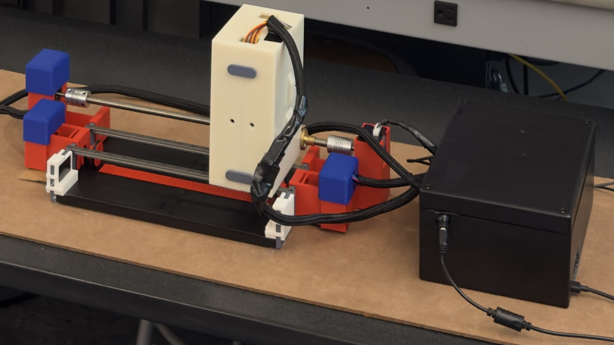

# BraiLink: open source braille printer



A comprehensive web application that converts text to Braille and sends it to a physical Braille printer via Raspberry Pi. The system includes OCR capabilities for handwritten text recognition, voice transcription, and real-time Braille preview.

## Features

- **Text to Braille Conversion**: Real-time conversion with preview
- **OCR (Optical Character Recognition)**: Upload images to extract handwritten text
- **Voice Transcription**: Record audio and convert speech to text
- **Braille Preview**: Live preview of how text will appear in Braille
- **Physical Printing**: Send Braille output to a physical printer via Raspberry Pi
- **Line Limit Validation**: Prevents printing if text exceeds maximum line limits
- **Responsive Design**: Modern UI built with React and TypeScript
- **Download Braille**: Export the preview as Unicode Braille text without a printer
- **Input Warnings**: See line usage and unsupported characters before printing

## Tech Stack

### Frontend
- **React 18** with TypeScript
- **Tailwind CSS** for styling
- **Vite** for build tooling
- **Web APIs**: MediaRecorder, getUserMedia for voice recording
- **Lucide React** for icons

The build uses Vite 8 and Tailwind CSS 4, with the Tailwind Vite plugin.
Theme tokens and animations remain in `tailwind.config.ts`, explicitly loaded
by `client/src/index.css`; `theme.json` still controls the generated colors.
Tailwind 4 requires modern browsers (Safari 16.4+, Chrome 111+, Firefox 128+);
see the [Tailwind migration guide](https://tailwindcss.com/docs/upgrade-guide).

### Backend
- **Node.js** with Express
- **TypeScript** for type safety
- **Multer** for file uploads

### AI/ML Services
- **Handwriting OCR**: your choice of OpenAI (or any OpenAI-compatible service such as OpenRouter or a local Ollama), Anthropic Claude, or Google Gemini
- **Voice transcription**: any OpenAI-compatible speech-to-text API (OpenAI Whisper, Groq, or a self-hosted Whisper server)

### Hardware Integration
- **Raspberry Pi** for Braille printer control
- **SSH** communication between the print server and Raspberry Pi

## What you need

- **The mechanical parts:** all of them are in the [Onshape CAD](hardware/README.md#cad). You'll need a 3D printer, or a printing service to order them from.
- **Parts to buy:** the electronics, linear rails, a lead screw, shaft couplers and rubber O-rings. See the [bill of materials](hardware/BOM.csv).
- **A computer** on the same network as the Raspberry Pi, to run the print server.

Then follow the [assembly guide](docs/assembly.md).

## Where things are

A print job flows top to bottom through these folders:

```
client/         The website people use: type, upload a photo or record speech, preview the braille
server/         Hosts the website and the AI features (handwriting OCR, speech-to-text)
shared/         The text-to-braille converter, used by both the preview and the printer
print-server/   Runs on a computer next to the printer and sends print jobs to the Pi over SSH
pi/             Scripts on the Raspberry Pi that move the motors and servos
hardware/       Everything physical: CAD, bill of materials, wiring diagram
docs/           Build guide and photos
scripts/        Developer tools (production smoke test)
```

Each folder has its own README with more detail. Configuration for both servers is documented in [`.env.example`](.env.example).

## Running

Use Node.js 22.12 or newer. Install dependencies with `npm ci`, then copy
`.env.example` to `.env` and fill in the settings you need. Both servers load
this file; environment variables supplied by your host take precedence.

The project has two servers:

- **Web app** (`npm run dev`, or `npm run build && npm start` in production): serves the UI plus the OCR and transcription APIs. Can be hosted anywhere.
- **Print server** (`npm run print-server`): must run on a machine on the same network as the Raspberry Pi, because it reaches the Pi over SSH.

The web app defaults to `http://localhost:5001` (`PORT` overrides it), and the
print server defaults to `http://localhost:3000` (`PRINT_PORT` overrides it).
Use separate terminals to run them together.

Set `VITE_PRINT_SERVER_URL` before building the web app so it knows where the
print server is, and set the print server's `ALLOWED_ORIGIN` to the web app's
URL. The URL must be reachable from the user's browser. An HTTPS web app needs
an HTTPS print endpoint. Keep the print server on a trusted network: it has no
authentication and controls physical hardware.

Configure `PI_HOST`, `PI_USER`, and `PI_SSH_KEY` for the Raspberry Pi. Establish
SSH access and its host key before printing. Set up the Pi by following [`pi/README.md`](pi/README.md). The Stop Printing action targets `completetest.py`.

Text editing, previews, and downloads work without API keys or hardware.
OCR needs a key for one provider (OpenAI, Anthropic or Gemini; choose with
`OCR_PROVIDER`), and transcription needs an OpenAI-compatible speech API. See
`.env.example` for every option.
Microphone recording requires a supported browser on HTTPS or localhost.
Images are limited to 10 MB and audio to 25 MB.

## Conversion behavior

Preview, download, and printing use the same basic six-dot mapping. Each line
holds 14 cells and a print job supports 10 lines. Long words are split with a
hyphen. Downloads may exceed the printer's line limit.

This is a simplified printer mapping, not a complete standards-compliant Braille
translator: uppercase letters become lowercase, and linguistic rules are not
fully implemented. Typographic punctuation (curly quotes, dashes, ellipses)
is converted to its plain equivalent. Other unsupported characters appear as
blanks in the preview and block printing and download until corrected. Pasted Windows line endings and
horizontal whitespace are normalized. Downloads are UTF-8 Unicode text, not BRF.

## Development checks

- `npm run check` — TypeScript validation
- `npm test` — conversion regressions and local API validation (no provider calls)
- `npm run build` — production client and web server build
- `npm run test:production` — starts the built server on a temporary local port and checks health, static assets, routing, and API errors

For deployment, install with `npm ci`, run checks and the build, then use
`npm start`. Build dependencies must be installed during the build step; the
runtime can use `npm ci --omit=dev` after the build. Use `/api/health` as the
HTTP health-check path. It checks web-server availability, not AI providers or
printer connectivity. Replit is configured for Node 22 and port 5001.

The API tests briefly open an ephemeral localhost port. Live provider responses,
microphone behavior, and physical printing need separate integration testing.

## Team

BraiLink was built by Sounak Bagchi, Priyam Kabra, Aditya Kirubakaran and Abhi Terala.

## License

- Software: [MIT](LICENSE)
- Hardware design files in `hardware/`: [CERN-OHL-P-2.0](hardware/LICENSE)
