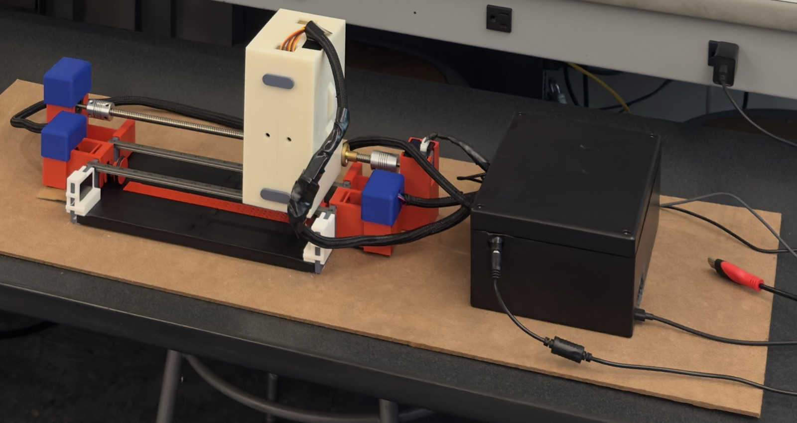

# Assembly

Before you start, print all the parts in the [print list](../hardware/cad/stl/README.md) and get the bought parts in the [bill of materials](../hardware/BOM.csv). Keep the [Onshape design](../hardware/README.md#cad) open while you build; it shows where every part goes.

## 1. Base, dies and paper feed

1. Lay the base plate flat.
2. Place the 17 die blocks in a row inside the base.
3. Slide the 245 mm steel rod through the die blocks to lock them in place.
4. Build the two paper advancers (the *Paper Advancer - Inside* subassembly in Onshape). Each one has:
   - the two paper advance shaft parts and a shaft spacer
   - a friction wheel with a rubber O-ring stretched around it
   - a flanged ball bearing
   - a NEMA 17 pancake stepper motor
5. Fit both paper advancers to the base, and check that the wheels turn freely and both touch the paper evenly.

## 2. Punch head

The head is two halves, each holding three servos (one column of braille dots).

1. **Set the servos to their rest position before fitting anything to them.** With the electronics wired, run `completetest.py --rest` on the Pi (see [`pi/README.md`](../pi/README.md)). This makes every punch start fully raised and line up with the others.
2. Stick each MG995 servo in place with **double-sided tape** and lay it on its supports in the head case. The tape only locates the servos; the closed case is what holds them. Once the head is closed, check that no servo can shift when it punches.
3. Fit a gear on each servo, and secure it with the servo's retaining screw.
   > A gear that's only pressed on can slowly slip on the servo spline. Gears or hubs made to fit the MG995's output spline hold best.
4. Fit the racks so each meshes with its gear, with the punches in place. **Check the alignment before closing the case:** each punch should slide straight without binding.
5. Close the head and seal it with the clips.
6. Route **all servo wires out of the top of the head**. Leave enough slack for the head's full travel along the rails, and secure the bundle so a tug on it doesn't pull on the servo connectors.

## 3. Rails and lead screw

1. Screw the two rail carriages onto the punch head, 4 screws each. The screws come with the rails.
2. Slide the head onto the two linear rails **before** fixing the rails in place. Then align the rails and secure them.
3. **Check that the head slides freely along the whole length of the rails** before going further. Fix any binding now; it's much harder to find once the lead screw is in.
4. Fit the two clip-together stepper motor holders, one at each end of the lead screw.
5. Put the lead screw in place through the two brass nuts on the head, and attach both nut brackets. The two nuts must line up exactly, or the screw will bind; turn the screw by hand from end to end to check.
6. Connect the lead screw to its motor (or both motors) with the shaft couplers, and tighten their set screws. If you use a bearing instead of the second motor, fit it at that end.

## 4. Wiring

Wire everything following the [wiring guide](../hardware/electronics/wiring.md), then set up the Pi with [`pi/README.md`](../pi/README.md).

- Keep every wire clear of the gears, racks, lead screw and paper path.
- Use **heat-shrink tubing** on soldered joints and to bundle cables neatly.

## 5. First tests

Work through the [calibration steps](../pi/README.md#calibration) before your first real print. In particular, confirm these before running a full page:

- **Homing:** the head moves toward the home switch and stops on it.
- **Motor directions:** the head and paper move the right way.
- **Punch clearance:** each punch goes into its die cleanly and lifts fully clear of the paper before the head moves.
