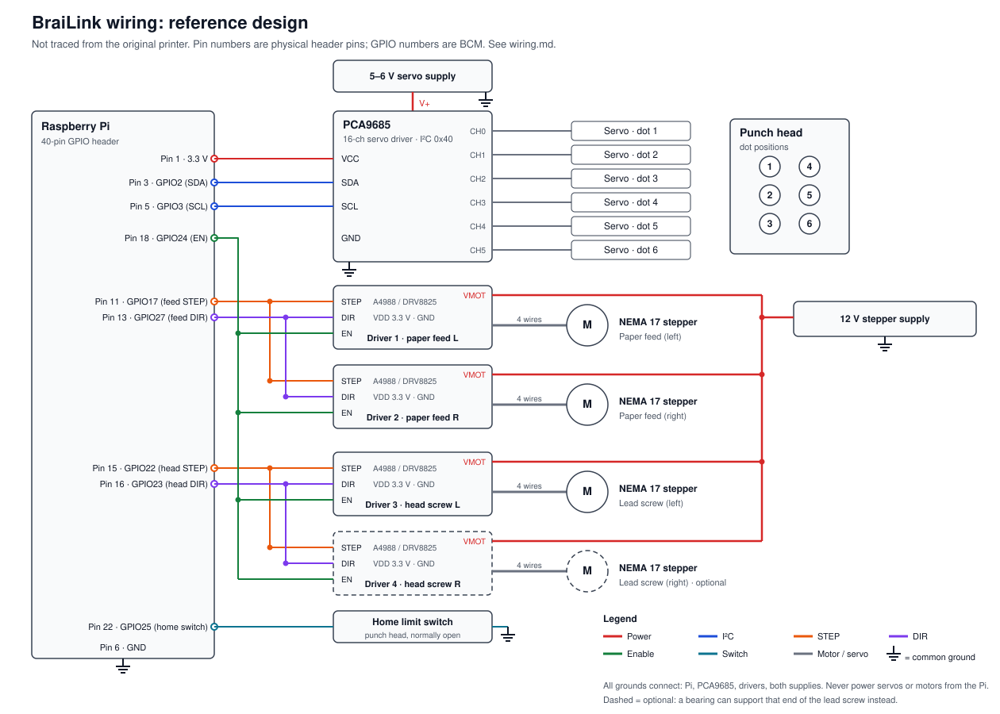

# Wiring: reference design

> **This is a reference design, not a trace of the original printer.** The original pin assignments live in `completetest.py` on the Pi, which isn't in this repository yet. If you're rebuilding the original, check this against that script first. If you're building fresh, this layout works with the parts listed below, and the Pi script just needs to use the same pins.

## Parts

| Part | Qty | Role |
|---|---|---|
| Raspberry Pi (any model with the 40-pin header) | 1 | Runs the print scripts |
| PCA9685 16-channel servo driver | 1 | Drives the six dot servos over I²C |
| MG995 servo | 6 | One per braille dot, in a 2×3 grid on the punch head |
| NEMA 17 pancake stepper motor | 3 or 4 | Two advance the paper; one or two turn the lead screw that moves the punch head |
| Step/dir stepper driver (A4988, DRV8825 or TMC2209) | 3 or 4 | One per stepper |
| Normally-open limit switch | 1 | Tells the Pi when the punch head is at its home position |
| 5–6 V power supply | 1 | Servos only |
| 12 V power supply | 1 | Steppers only |
| 100 µF electrolytic capacitor | 3 or 4 | One across each driver's VMOT and GND |

## Raspberry Pi pins

Physical pin numbers count along the header; GPIO numbers are the BCM numbers used in code.

| Pin | GPIO | Connects to | Notes |
|---|---|---|---|
| 1 | 3.3 V | PCA9685 VCC, VDD on all four drivers | Logic power only |
| 3 | GPIO2 (SDA) | PCA9685 SDA | Enable I²C with `raspi-config` |
| 5 | GPIO3 (SCL) | PCA9685 SCL | |
| 6 | GND | Common ground | |
| 11 | GPIO17 | STEP on drivers 1 and 2 (paper feed) | Both paper motors step together |
| 13 | GPIO27 | DIR on drivers 1 and 2 | |
| 15 | GPIO22 | STEP on drivers 3 and 4 (lead screw) | Both screw motors step together. Driver 4 is optional |
| 16 | GPIO23 | DIR on drivers 3 and 4 | |
| 18 | GPIO24 | EN on all four drivers | Active low: drive it low to enable the motors, high to let them rest |
| 22 | GPIO25 | Home limit switch (other leg to GND) | Use the Pi's internal pull-up; reads low when pressed |

## Servo channels

| PCA9685 channel | Dot |
|---|---|
| CH0 | 1 (top left) |
| CH1 | 2 (middle left) |
| CH2 | 3 (bottom left) |
| CH3 | 4 (top right) |
| CH4 | 5 (middle right) |
| CH5 | 6 (bottom right) |

Each servo plugs into its channel's 3-pin header: signal, V+ and GND. The servos draw power from the PCA9685's V+ terminal, which connects to the 5–6 V supply, never to the Pi.

The print server sends each cell as six digits in dot order **3, 2, 1, 6, 5, 4**: the first digit is dot 3, the fourth is dot 6. The Pi script must map those digits back to the channels above.

## Power

- **Three separate supplies:** the Pi has its own USB power, the servos get 5–6 V and the steppers get 12 V. Motors and servos must never draw from the Pi's 5 V or 3.3 V pins.
- **Common ground:** connect the grounds of the Pi, the PCA9685, all four drivers and both supplies. Without this, the step and servo signals have no reference and behave erratically.
- **Servo supply size:** six servos punching at once draw a lot of current. Allow roughly 1–2 A per servo, depending on the model.
- **Stepper supply size:** allow about 1.5 A per NEMA 17 motor, so 12 V at 5 A or more for four.
- **Driver capacitors:** put a 100 µF capacitor across VMOT and GND on each driver, as close to the driver as possible. Voltage spikes without it can destroy the driver.

## Notes

- **One or two lead screw motors:** both motors turn the same lead screw, one at each end. You can replace the second motor with a bearing that supports that end of the screw. In that case, leave out driver 4 and its motor; nothing else changes.

- **Mirrored motor pairs:** if the two motors in a pair face each other, they need to turn in opposite directions. Reverse one by swapping the two wires of one coil, for example A+ and A−, **with the power off**.
- **Driver current:** set each driver's current limit with its potentiometer before connecting a motor. Follow the datasheet for your driver.
- **Microstepping:** the MS1–MS3 pins on A4988/DRV8825 boards set microstepping. Wire them the same way on both drivers of a pair.
- **Never unplug a motor while its driver is powered.** This can destroy the driver.
